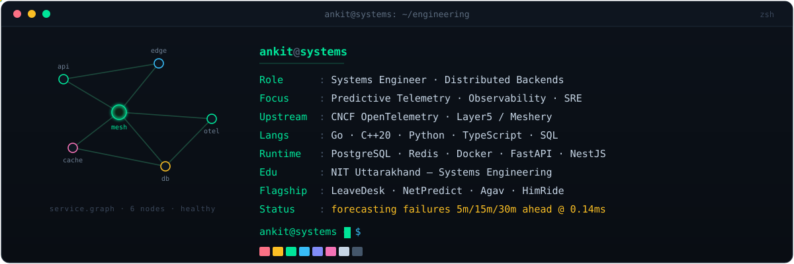

<!-- ╔══════════════════════════════════════════════════════════════════╗ -->
<!--                  ANKIT KUMAR PATEL · github profile                  -->
<!-- ╚══════════════════════════════════════════════════════════════════╝ -->

  
  
  

  
  
  
  
  

 

---

### 🌐 &nbsp;CNCF &amp; Cloud-Native Upstream Engineering

| Ecosystem | Project &amp; Repository | Upstream Focus &amp; Contributions | Status |
| :--- | :--- | :--- | :---: |
| **CNCF** | [`open-telemetry/opentelemetry-go-contrib`](https://github.com/open-telemetry/opentelemetry-go-contrib) | Fixed HTTP 3xx middleware status-code propagation in AWS SDK v2 tracing instrumentation ([PR #10077](https://github.com/open-telemetry/opentelemetry-go-contrib/pull/10077)) &amp; OTLP endpoint validation ([PR #10076](https://github.com/open-telemetry/opentelemetry-go-contrib/pull/10076)). | 🟢 **Approved by Core Maintainer** |
| **Layer5 / CNCF** | [`layer5io/gowrk2`](https://github.com/layer5io/gowrk2) | High-performance HTTP benchmarking tooling for Meshery ([PR #26](https://github.com/layer5io/gowrk2/pull/26)). | 🟣 **Merged to Master** |
| **Layer5 / CNCF** | [`layer5io/mesheryctl-aliases`](https://github.com/layer5io/mesheryctl-aliases) | CLI ergonomics and issue-discovery pipelines for Meshery ([PR #22](https://github.com/layer5io/mesheryctl-aliases/pull/22)). | 🟣 **Merged to Master** |
| **Layer5 / CNCF** | [`layer5io/layer5`](https://github.com/layer5io/layer5) | Official Community Member Profile for Ankit Kumar Patel ([PR #8276](https://github.com/layer5io/layer5/pull/8276)). | 🔵 **All Checks Passed** |

---

### 🛰️ &nbsp;Engineering Cockpit &amp; Systems Blueprint

| Operational Domain | Technical Focus &amp; Systems Depth |
| :--- | :--- |
| **🔭 Distributed Telemetry &amp; Prediction** | Multi-horizon early-warning failure forecasting (5m, 15m, 30m), TreeSHAP feature attributions, Isotonic Calibration, Conformal Prediction. |
| **🤖 Autonomous Agent Runtimes** | Terminal-native code-editing engines, LSP AST parsing, multi-provider LLM orchestration (Anthropic, OpenAI, OpenRouter, Gemini, Ollama), sandboxed CI/CD. |
| **⚙️ High-Throughput Backends** | Transactional ACID seat/gatepass allocation engines, PostgreSQL row-level locks (RLS &amp; `SELECT FOR UPDATE`), POSIX sockets, Redis caching, Celery queues, FastAPI. |
| **📡 Mission-Critical Client Systems** | React 19, TypeScript, responsive incident-response cockpits, low-latency live telemetry streams, offline-resilient local sync. |

---

### 🚀 &nbsp;Production Flagship Systems

<table>
  <tr>
    <td width="50%" valign="top">
      <h3 align="left">🏢 LeaveDesk — Campus Gatepass &amp; Security Engine</h3>
      
<b>Production Institutional Platform (<a href="https://leavedesk.nituk.ac.in">leavedesk.nituk.ac.in</a>)</b> • <i>Live on Official University Server</i>

      <ul>
        <li>End-to-end leave management &amp; campus perimeter security for <b>NIT Uttarakhand</b> — 700+ active students &amp; faculty, 99.9% uptime.</li>
        <li><b>Multi-Tier Authorization:</b> approval pipeline orchestrating state flow across Students &rarr; Faculty Advisors &rarr; Wardens.</li>
        <li><b>Concurrency &amp; ACID:</b> PostgreSQL row-level locking (<code>SELECT FOR UPDATE</code>) eliminating race conditions under peak traffic.</li>
        <li><b>Dynamic Verification:</b> cryptographic QR validation with anti-replay timestamp checks for physical checkpoints.</li>
      </ul>
      
<code>PostgreSQL 16</code> <code>Node.js</code> <code>TypeScript</code> <code>React 19</code> <code>SSE</code> <code>Docker</code> <code>Nginx</code>

    </td>
    <td width="50%" valign="top">
      <h3 align="left">⚡ NetPredict — Network Telemetry Intelligence</h3>
      
<b>Congestion &amp; Link-Failure Forecaster (<a href="https://netpredict-cockpit.vercel.app">Live Cockpit</a> • <a href="https://huggingface.co/datasets/The-AnkitPatel/ebpf-network-telemetry">HF Dataset</a>)</b>

      <ul>
        <li>Predicts link congestion &amp; buffer overflow <b>5m / 15m / 30m ahead</b> before packet loss hits throughput — 0.14ms inference latency.</li>
        <li><b>Root-Cause Explainability:</b> queue buildup &amp; latency slopes via <b>TreeSHAP</b> + Conformal Prediction uncertainty intervals.</li>
        <li><b>Dual Ingestion:</b> live hardware socket-counter polling paired with zero-overhead browser simulation.</li>
        <li>Interactive <i>"What-If"</i> lab to test rerouting &amp; buffer adjustments with live feedback.</li>
      </ul>
      
<code>Python 3.12</code> <code>FastAPI</code> <code>React 19</code> <code>LightGBM</code> <code>TreeSHAP</code> <code>Docker</code>

    </td>
  </tr>
  <tr>
    <td width="50%" valign="top">
      <h3 align="left">🤖 Agav — Terminal-Native Autonomous AI Agent</h3>
      
<b>CLI Coding Assistant for Real Repositories (<a href="https://github.com/prapaa-ai/agav">github.com/prapaa-ai/agav</a>)</b>

      <ul>
        <li>Terminal-native agent that inspects, refactors &amp; tests multi-file codebases directly from the CLI.</li>
        <li><b>Multi-Provider Engine:</b> swappable LLM orchestration — Anthropic, OpenAI, OpenRouter, Gemini, local-first Ollama — with mid-session switching.</li>
        <li>Benchmarked on <b>Terminal-Bench 2.1 (84.7%)</b> &amp; SWE-bench Live.</li>
        <li>Sandboxed command execution, automated git branching, AST inspection, non-interactive CI/CD mode.</li>
      </ul>
      
<code>Python</code> <code>TypeScript</code> <code>Linux PTY</code> <code>Docker</code> <code>AST</code> <code>LLM Tooling</code>

    </td>
    <td width="50%" valign="top">
      <h3 align="left">🏔️ HimRide — State Transit &amp; Fleet Logistics</h3>
      
<b>High-Concurrency Booking &amp; Dispatch Infrastructure (Govt. of Uttarakhand)</b>

      <ul>
        <li>Multi-tier state transit platform coordinating routes, seat reservations &amp; fleet telematics.</li>
        <li>Low-latency seat-matrix allocation with transactional ACID integrity to prevent race conditions at peak demand.</li>
        <li>Raised financial settlement throughput <b>3&times; (230 &rarr; 695/s)</b> and cut p99 latency <b>12&times; (1.8s &rarr; 146ms)</b> via append-only ledger entries.</li>
      </ul>
      
<code>NestJS</code> <code>TypeScript</code> <code>PostgreSQL</code> <code>Redis Pub/Sub</code> <code>Uber H3</code> <code>Expo</code> <code>Docker</code>

    </td>
  </tr>
</table>

---

### 🛠️ &nbsp;Technical Arsenal

| Core Infrastructure | Verified Technologies |
| :--- | :--- |
| **Languages** | `Go` `C++20` `Python 3.12` `TypeScript` `JavaScript` `SQL` `Bash` |
| **Telemetry &amp; Predictive ML** | `OpenTelemetry` `LightGBM` `TreeSHAP` `Isotonic Calibration` `Conformal Prediction` `PyTorch` `Pandas` |
| **Backend &amp; Cloud** | `NestJS` `FastAPI` `Node.js` `PostgreSQL 16` `Redis Pub/Sub` `Docker` `Nginx` `gRPC` |
| **Frontend &amp; Cockpits** | `React 19` `Tailwind CSS` `Next.js` `Vite` `Chart.js` `Recharts` |
| **DevOps &amp; Tooling** | `Git` `GitHub Actions` `Linux Internals` `POSIX Sockets` `GDB` `strace` `Playwright` |

 

---

### 📊 &nbsp;Telemetry &amp; Activity Analytics

  

---

### 🐍 &nbsp;Real-Time Contribution Telemetry

<picture>
  <source media="(prefers-color-scheme: dark)" srcset="https://raw.githubusercontent.com/The-AnkitPatel/The-AnkitPatel/output/snake-dark.svg" />
  <source media="(prefers-color-scheme: light)" srcset="https://raw.githubusercontent.com/The-AnkitPatel/The-AnkitPatel/output/snake.svg" />
  
</picture>

  

<code>ankit@systems</code> · traced all the way down · thanks for following the span 🟢

