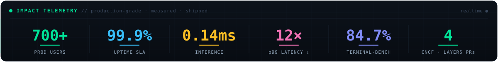
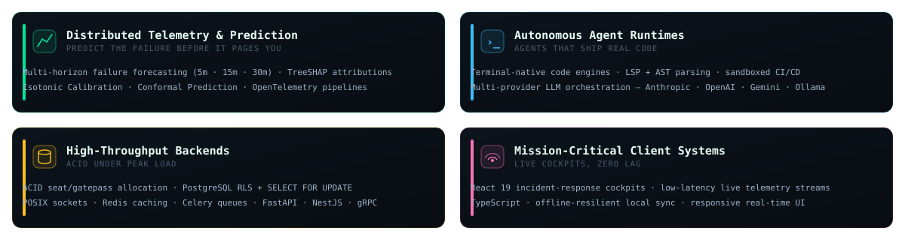
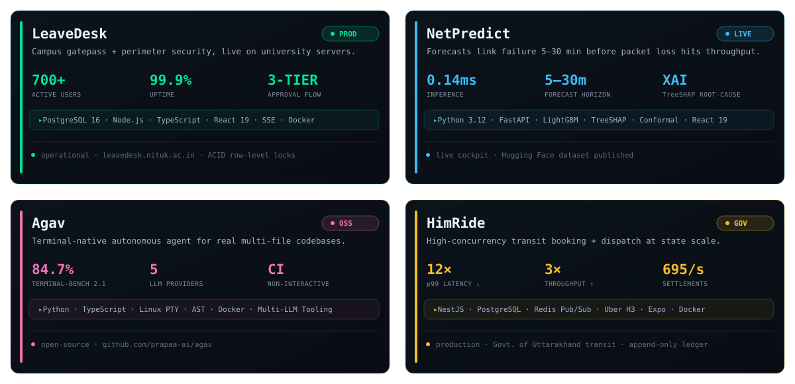

<!-- ╔══════════════════════════════════════════════════════════════════╗ -->
<!--                  ANKIT KUMAR PATEL · github profile                  -->
<!-- ╚══════════════════════════════════════════════════════════════════╝ -->

  
  
  

  
  
  
  
  

  

  

---

**I ship code into the infrastructure that runs the cloud-native world** — merged upstream in **CNCF OpenTelemetry** and **Layer5 / Meshery**, reviewed and signed off by core maintainers.

| Ecosystem | Project &amp; Repository | Upstream Contribution | Status |
| :--- | :--- | :--- | :--- |
| **CNCF** | [`opentelemetry-go-contrib`](https://github.com/open-telemetry/opentelemetry-go-contrib) | Fixed HTTP 3xx middleware status-code propagation in AWS SDK v2 tracing instrumentation ([#10077](https://github.com/open-telemetry/opentelemetry-go-contrib/pull/10077)) &amp; OTLP endpoint validation ([#10076](https://github.com/open-telemetry/opentelemetry-go-contrib/pull/10076)). |  |
| **Layer5 / CNCF** | [`gowrk2`](https://github.com/layer5io/gowrk2) | High-performance HTTP benchmarking engine for Meshery ([#26](https://github.com/layer5io/gowrk2/pull/26)). |  |
| **Layer5 / CNCF** | [`mesheryctl-aliases`](https://github.com/layer5io/mesheryctl-aliases) | CLI ergonomics &amp; issue-discovery pipelines for Meshery ([#22](https://github.com/layer5io/mesheryctl-aliases/pull/22)). |  |
| **Layer5 / CNCF** | [`layer5`](https://github.com/layer5io/layer5) | Official Community Member Profile ([#8276](https://github.com/layer5io/layer5/pull/8276)). |  |

---

  

---

**Four production systems. Real users, real traffic, numbers that hold under load.**

  
  
  
  

---

  

**PREDICTIVE TELEMETRY &amp; ML** — the differentiators behind NetPredict

  
  
  
  
  
  
  

---

  

  

<picture>
  <source media="(prefers-color-scheme: dark)" srcset="https://raw.githubusercontent.com/The-AnkitPatel/The-AnkitPatel/output/snake-dark.svg" />
  <source media="(prefers-color-scheme: light)" srcset="https://raw.githubusercontent.com/The-AnkitPatel/The-AnkitPatel/output/snake.svg" />
  
</picture>

  

<code>ankit@systems</code> · traced all the way down · thanks for following the span 🟢

